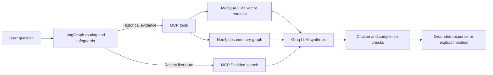

# Medical Agentic GraphRAG

**A research prototype for source-grounded biomedical question answering**, combining semantic retrieval, a Neo4j documentary knowledge graph, LangGraph agent workflows, Model Context Protocol (MCP) tools, and PubMed-indexed literature.

> **Research and educational use only.** This project is not a medical device or a clinically validated decision-support system. Its outputs must not be used as patient-specific medical advice.

## Overview

The assistant routes questions to historical biomedical documents or PubMed-indexed literature, retrieves supporting evidence, and produces answers with document identifiers and validation checks. It distinguishes historical MedQuAD content from searches for more recent publications.

### Architecture



## Implemented components

| Component | Scope |
| --- | --- |
| Historical corpus | 200 MedQuAD documents split into 750 indexed chunks |
| Vector retrieval | Sentence-Transformers `all-MiniLM-L6-v2` (384-dimensional embeddings) |
| Graph retrieval | Neo4j provenance graph and 14 **pilot documentary** disease–symptom claims |
| Agent | LangGraph orchestration with a Groq-hosted LLM |
| MCP | Four tools for corpus statistics, vector retrieval, graph claims and PubMed searches |
| Evaluation | Retrieval benchmarks, exploratory RAGAS experiments, citation checks and automated tests |

The 14 pilot graph claims are linked to source passages; they have **not** been independently clinically validated.

### MCP tools

| Tool | Purpose |
| --- | --- |
| `statistiques_medquad_v3` | Corpus and index statistics |
| `rechercher_passages_v3` | Historical semantic passage retrieval |
| `symptomes_neo4j_v3` | Documentary disease–symptom graph retrieval |
| `rechercher_guidelines_pubmed_actuelles_v1` | Search for relevant PubMed-indexed publications; not a guarantee of official or latest guidelines |

## Repository structure

```text
Medical-Agentic-GraphRAG/
├── src/
│   └── medical_graphrag/    # Agents, retrieval, Neo4j and MCP modules
├── tests/                  # Automated and regression tests
├── .env.example            # Environment variable template, without secrets
├── .gitignore
├── run.py                  # Agent command-line launcher
├── run_tests.py            # Automated test runner
└── README.md
```

The current `src/medical_graphrag/` directory intentionally keeps existing modules together to preserve their imports. Splitting them into fully packaged submodules is a future refactoring step.

## Running locally

**Prerequisites:** Python 3.12, project dependencies, a prepared local MedQuAD V3 index, and the credentials required by the chosen integrations.

1. Create and activate a Python virtual environment.
2. Install the project dependencies used by the modules. A clean-install, version-pinned `requirements.txt` has **not yet been validated**; historical dependency notes are available in `docs/development/`.
3. Use `.env.example` as a template and configure `src/medical_graphrag/.env` locally. Do not commit credentials.
4. Prepare the local corpus/index data. These generated resources are excluded from Git and are not distributed with the repository.
5. From the repository root, run:

```powershell
python run.py --check
python run_tests.py
python run.py --question "What are the symptoms of acromegaly?"
python run.py --question "What are the latest clinical guidelines for treating acromegaly?"
```

The launcher also supports `--mode mcp` for the historical MCP workflow and `--mode web` for the workflow that can route recent-literature questions (default). External calls require working network access and configured services.

## Evaluation

### Retrieval benchmark

An exploratory retrieval benchmark of **35 positive anchor questions** produced:

| Metric | Result |
| --- | ---: |
| AnchorHit@1 | 60.0% |
| AnchorHit@3 | 82.9% |
| AnchorHit@5 | 91.4% |
| AnchorMRR@5 | 0.720 |

These measurements describe passage retrieval on this small benchmark; they do **not** establish medical accuracy or generalization to other datasets.

### Vector RAG vs. GraphRAG pilot

A **two-question exploratory comparison** examined Vector RAG and hybrid GraphRAG. Both approaches produced structurally recognized chunk citations. The hybrid approach **did not establish a general improvement in response quality** and added latency in those runs. A recognized citation identifier is not, by itself, proof that a generated statement is fully supported by its source.

### Automated checks

At the time of the repository reorganization, **151 automated tests passed locally**, covering agent safeguards, retrieval integrity, Neo4j, MCP contracts, citation handling and evaluation utilities. A real historical-question run also completed successfully. These checks are not equivalent to an independent clinical evaluation or exhaustive integration testing.

## Limitations

- MedQuAD is a historical documentary source, **not** a source of automatically current clinical recommendations.
- PubMed results supply indexed records and abstracts; they do not guarantee identification of the latest **official** guidelines or substitute for reading the issuing society's full publication.
- The Neo4j disease–symptom relations are a small, source-anchored research pilot, not a clinically approved knowledge base.
- GraphRAG results were compared on a very small pilot; no broad performance superiority is claimed.
- Full clean-environment dependency reproducibility and deployment are future work.
- The system must not be used to diagnose, treat or advise individual patients.

## Development notes

See [`docs/development/`](docs/development/) for historical implementation guides, experimental decisions and known technical issues, including index integrity, graph provenance, MCP output normalization, response truncation and PMID citation verification.

## Author

**Mohamed Youssef Abdelhedi**
